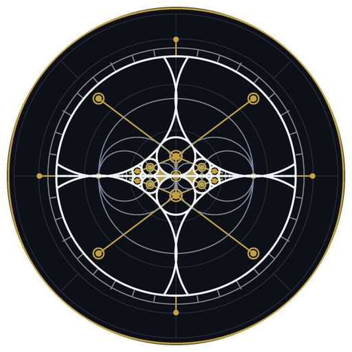
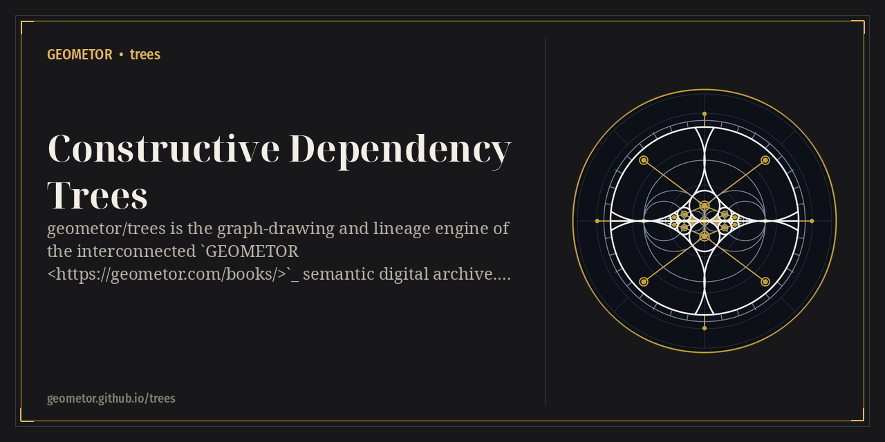

<a href="https://geometor.github.io/trees/"></a>

# GEOMETOR • trees

**Visit the Online Archive:** https://geometor.github.io/trees/

<p align="center">
  <a href="https://geometor.github.io/trees/"></a>
</p>

**Constructive Dependency Trees • Stern–Brocot & monotone planar tree drawings**

## Mission

`geometor/trees` is part of the interconnected [GEOMETOR](https://geometor.com) semantic digital archive. It provides graph-drawing algorithms, monotone layout engines, and constructive dependency structures for rooted trees and geometric ancestry. By translating constructive compass-and-straightedge histories into balanced parenthesis sequences, Stern–Brocot angle assignments, and monotone planar drawings, it liberates abstract geometric lineages into cleanly traversable hierarchical trees across the GEOMETOR corpus.

## Capabilities & Interactive Docs

- [Constructive Dependency Trees](https://geometor.github.io/trees/) — Monotone graph drawing algorithms and constructive dependency structures.
- [Monotone Tree Layouts](https://geometor.github.io/trees/) — Implementations of Angelini et al., He & He, and Stern–Brocot angle-assignment algorithms for compact grid embeddings.
- [Parenthesis Encodings](https://geometor.github.io/trees/) — Canonical balanced parenthesis string encodings and exhaustive generation of distinct rooted trees.

## Repository Contents

- `docsrc/` — RST technical documentation and algorithm overviews compiled by [PHOTON publish](https://github.com/photon-platform/publish).

## Local Build & Verification

```bash
publish build
```
## Part of the GEOMETOR Knowledge Archive

Explore all **74 Book Codices** and **11 Mathematical Catalogs** at https://geometor.com/books/.
