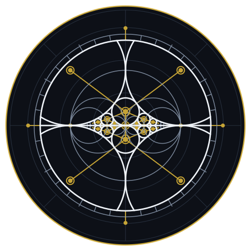

:site_title: Constructive Dependency Trees

.. container:: author-overline

   semantic digital archive • symbolic engine

=============================
Constructive Dependency Trees
=============================

``geometor/trees`` is the graph-drawing and lineage engine of the interconnected `GEOMETOR <https://geometor.com/books/>`_ semantic digital archive. It studies monotone planar layout algorithms and parent-child dependency trees, mapping balanced parenthesis sequences onto geometric coordinate grids where constructive lineages can be traversed with directional monotonicity.

Core Algorithms
---------------

- **Monotone Tree Drawings**: Implementation of Angelini et al. and He & He algorithms for grid-embedded monotone trees.
- **Parenthesis Encodings**: Canonical balanced string representations of rooted and ordered trees.
- **Ancestry Hierarchies**: Structural analysis of constructive dependency graphs where geometric primitives derive from intersection sequences.

----

Indices
-------

* :ref:`genindex`
* :ref:`search`
